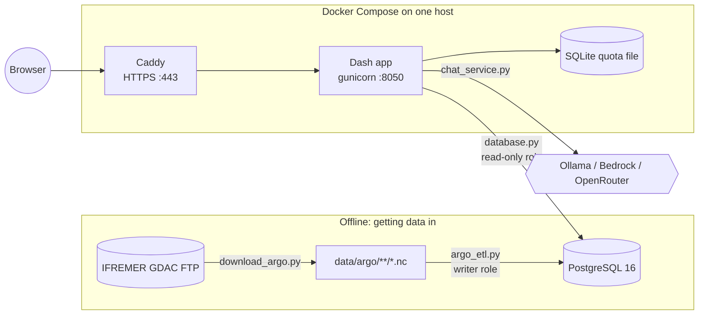

# FloatChat: project guide

What every part of FloatChat does, how the parts fit together, and how to run, change and
deploy it. First written from commit `20f329b`, then updated for the region-analysis work on
branch `feature/region-analysis` (18 October 2026; plan in
[execution-plan.md](execution-plan.md)).

---

## Contents

1. [What FloatChat is](#1-what-floatchat-is)
2. [What changed since the first version](#2-what-changed-since-the-first-version)
3. [Argo in five minutes](#3-argo-in-five-minutes)
4. [Architecture](#4-architecture)
5. [Repository map](#5-repository-map)
6. [Getting data in: `download_argo.py`](#6-getting-data-in-download_argopy)
7. [Loading data: `argo_etl.py`](#7-loading-data-argo_etlpy)
8. [The database: `schema.sql`](#8-the-database-schemasql)
9. [Read-only access: `database.py`](#9-read-only-access-databasepy)
10. [The dashboard: `app.py`](#10-the-dashboard-apppy)
11. [The AI assistant: `chat_service.py` and `ocean_tools.py`](#11-the-ai-assistant-chat_servicepy-and-ocean_toolspy)
12. [Optional MCP server: `postgres_mcp.py`](#12-optional-mcp-server-postgres_mcppy)
13. [Styling: `assets/style.css`](#13-styling-assetsstylecss)
14. [Configuration reference](#14-configuration-reference)
15. [Running it](#15-running-it)
16. [Deployment, tests and CI](#16-deployment-tests-and-ci)
17. [Known gaps and gotchas](#17-known-gaps-and-gotchas)
18. [Where to make common changes](#18-where-to-make-common-changes)
19. [Glossary](#19-glossary)

---

## 1. What FloatChat is

FloatChat is a web dashboard for exploring **Argo ocean float data**, focused on the Indian
Ocean. It has four parts:

- **A full-screen map** of every profile (each place a float surfaced and measured the water
  column). Click a dot to inspect it; pick a float to see its whole trajectory.
- **A profile inspector** that charts temperature, salinity and biogeochemistry (oxygen,
  chlorophyll, nitrate, backscatter) against pressure, plus a temperature–salinity diagram.
- **Charts from any question**: one validated *analysis request* covers a statistic (mean,
  median, min, max, standard deviation, count, 10th/90th percentile) of a measurement, grouped by
  time, season, depth, float or latitude/longitude band, for a named region (including
  approximate ocean boxes) or a box, optionally comparing up to four regions, floats or years,
  drawn as a line, bar, depth profile, histogram, scatter or map. Available from the **Analyze**
  tab without any AI, from the assistant, and over MCP. When the data can't answer, it says why
  ("No profiles in the Pacific Ocean (approximate box) at all…").
- **An AI assistant** ("Ask AI") that answers plain-English questions from the database. It
  never writes SQL. The model picks one of nine fixed operations and fills in validated
  arguments, Python runs it, and the model explains the result. Answers can select a profile,
  highlight a region or open a chart. It runs on open-weight models through Ollama, Amazon
  Bedrock or OpenRouter. Visitors can paste their own OpenRouter key.

Under the hood: **Python 3.12, Dash 3 / Plotly 6** for the UI, **PostgreSQL 16** for the
data, **netCDF4** to read Argo files, **Pydantic** to validate AI tool calls, and **Docker
Compose + Caddy** to host it (target: one AWS Lightsail instance, about $12/month).

---

## 2. What changed since the first version

The project has two eras. The first commit (`ce741b9`, April 2026) was the original
prototype. Kartik's five commits on 18 October 2026 rebuilt most of it.

| Commit | What it did |
| --- | --- |
| `ce741b9` "added whole project" | Original prototype: Dash app, ETL, MCP server, schema. |
| `3e76bcd` "readme updated" | README. |
| `b7e94c0` Docker + Lightsail kit | **The big rewrite.** New AI pipeline, read-only DB layer, rewritten ETL, Docker, Caddy, CI, tests, AWS guide. |
| `4ef5227` Lightsail script fix | Launch script made POSIX `sh`-safe; notes on plan-size limits for new AWS accounts. |
| `dfdd0cc` Materialized summary | `profile_summary` became a materialized view; ETL refreshes it; `--pattern` flag for `Sprof` imports. |
| `4b6852c` Redesign + OpenRouter | New dashboard layout, OpenRouter provider, visitor API keys, per-key quotas. |
| `20f329b` Restyle | Full-screen map with floating "glass" panels, Geist font, emerald accent, motion, skeleton loaders. |
| `feature/region-analysis` | Region filters (equator, months, ocean boxes), the `analyze` engine for any chart, map highlight, Analysis panel, Analyze tab, honest no-data answers, MCP parity, data-mode re-import fix, true KPI totals, README rewrite. See [execution-plan.md](execution-plan.md). |

### Before and after

| Area | First version | Now |
| --- | --- | --- |
| **AI model** | OpenAI GPT-4o via `langchain-openai` | Open-weight models: Ollama (local), Bedrock (Qwen3 32B), OpenRouter (Qwen3 235B, Llama 3.3 70B, Mistral Small, Gemma 4). No OpenAI anywhere. |
| **Agent design** | LangGraph ReAct agent loading MCP tools, including `query_data`, which ran **any** `SELECT` the model wrote | Two model calls: (1) choose one of 9 fixed tools as JSON (one repair allowed), (2) explain the result. Model-written SQL is impossible. |
| **DB access** | Plain connection with whatever user was configured | Separate read-only role, read-only sessions, statement/lock timeouts, row caps. |
| **ETL** | ~490 lines, no provenance | QC filtering, adjusted values, per-file transactions, provenance columns, safe re-imports, summary refresh. |
| **Map stats** | `profile_summary` plain view (recomputed on every page load) | Materialized view, refreshed after each import. |
| **UI** | "Dark ocean" theme, three fixed columns | Full-screen map, floating panels, responsive down to phone width. |
| **Hosting** | Run `python app.py` locally | Docker Compose (Postgres + gunicorn + Caddy HTTPS), Lightsail scripts. |
| **Tests** | None | 39 unit/integration tests + CI that boots the real stack. |
| **Dependencies dropped** | `langchain`, `langchain-openai`, `langchain-mcp-adapters`, `langgraph`, `nest_asyncio`, `loguru`, `xarray` | Added `pydantic`, `requests`, `boto3`, `gunicorn`. |

---

## 3. Argo in five minutes

You need this vocabulary to read the code.

- **Argo float**: a robotic instrument drifting in the ocean. Roughly every 10 days it sinks
  to about 2,000 m, rises to the surface measuring as it goes, sends the data by satellite,
  and sinks again.
- **WMO ID**: the float's 5–8 digit ID number (e.g. `2902115`). Primary key of `floats`.
- **Cycle / profile**: one dive-and-rise. Each one produces a **profile**: measurements at
  many depth levels at one location and time. Identified by `(wmo_id, cycle_number,
  direction)`, where direction is `A` (ascending, the normal case) or `D` (descending).
- **Pressure (dbar)**: depth is recorded as pressure. 1 dbar ≈ 1 m of depth. Charts put
  pressure on a reversed y-axis so the surface is at the top.
- **Core vs BGC**: core floats measure pressure, temperature and salinity (PRES, TEMP,
  PSAL). **BGC** (biogeochemical) floats also measure oxygen (DOXY), chlorophyll-a (CHLA),
  nitrate (NITRATE) and particle backscatter (BBP700).
- **Data mode**: `R` real-time (raw, automatic checks), `A` real-time adjusted, `D` delayed
  mode (checked by a scientist, best quality). For `A`/`D`, the corrected values live in
  `<PARAM>_ADJUSTED` variables.
- **QC flags**: each value has a quality flag 0–9. `1` = good, `2` = probably good,
  `3`/`4` = probably bad / bad, `9` = missing. FloatChat keeps only 1 and 2.
- **DAC / GDAC**: Data Assembly Centres process data from their own floats (INCOIS for India,
  code `IN`; AOML for the US; Coriolis for France…). Global DACs such as IFREMER mirror it
  all.
- **JULD**: the timestamp, stored as days since 1950-01-01 UTC.
- **File types** (all NetCDF `.nc`):

  | File | Contains |
  | --- | --- |
  | `R2902115_001.nc` / `D2902115_001.nc` | Core data for cycle 1, real-time or delayed |
  | `BR…` / `BD…` | BGC data for that cycle |
  | `SR…` / `SD…` | "Synthetic": core + BGC merged onto one grid |
  | `2902115_Sprof.nc` | Synthetic data for **all** cycles of a float in one file |

  **Rule used everywhere in this project:** for any one float, import either the `Sprof`
  file **or** the core + BGC files, never both. Otherwise every measurement appears twice.

---

## 4. Architecture



There are two separate paths into the database:

1. **Write path (offline).** `download_argo.py` fetches NetCDF files. `argo_etl.py` reads
   them, cleans them, and writes to Postgres as the admin/writer role. Run by hand.
2. **Read path (online).** The Dash app and the AI tools only read, through `database.py`,
   as the `floatchat_reader` role. The web app never holds write credentials.

### How a page load works

1. The browser loads the Dash layout. The map starts empty and panels show skeleton
   placeholders.
2. The `load_data` callback fires. It reads up to 5,000 profiles from `profile_summary`, the
   float list, and any current selection, then returns the map figure, float list data, KPI
   tiles and status text.
3. `render_float_list` turns the float data into buttons.

### How a click works

1. Clicking a map dot sends `clickData` that includes the profile's `[profile_id, wmo_id]`
   (stored in `customdata`).
2. `select_profile` writes them into the `selected-profile` and `selected-wmo` stores.
3. Two callbacks react:
   - `update_map_selection` patches only the trajectory and highlight traces (not all 5,000
     dots) and re-frames the map when the float changes.
   - `update_profile_charts` queries that profile's observations and redraws the inspector.

### How a chat question works

```mermaid
sequenceDiagram
    participant U as Browser
    participant A as app.py handle_chat
    participant C as chat_service.answer_question
    participant M as Model (Ollama/Bedrock/OpenRouter)
    participant T as ocean_tools
    participant D as Postgres (read-only)

    U->>A: question (+ visitor key, model choice)
    A->>C: query, last 6 history items, client IP
    C->>C: validate input, check key, reserve quota
    C->>M: Call 1: "pick one tool, reply JSON"
    M-->>C: {"tool": "search_profiles", "arguments": {...}}
    C->>T: Pydantic-validate plan, then execute_tool
    T->>D: fixed, parameterised SQL
    D-->>T: rows
    T-->>C: result dict
    C->>M: Call 2: "answer using only this result"
    M-->>C: answer text
    C-->>A: answer, optional {profile_id, wmo_id}
    A-->>U: chat bubble; map/inspector jump to that profile
```

---

## 5. Repository map

```
FloatChat/
├── app.py                 Dash dashboard: layout, figures, callbacks, health endpoints
├── chat_service.py        AI pipeline: providers, quotas, plan (+1 repair) → tool → answer → actions
├── ocean_tools.py         The 9 validated read-only operations the AI may use (tool registry)
├── analysis.py            The analysis engine: AnalysisRequest → fixed SQL → result, diagnosis, coverage
├── charts.py              Plotly figures and captions for every analysis chart type
├── regions.py             Named regions (incl. approximate oceans) and the shared RegionFilter
├── theme.py               Design tokens and shared Plotly styling
├── database.py            Read-only, time-limited, row-capped Postgres access
├── argo_etl.py            NetCDF → Postgres importer (QC, provenance, re-import safe)
├── download_argo.py       FTP downloader for Argo files from the IFREMER GDAC
├── postgres_mcp.py        Optional MCP (stdio) server exposing the same operations
├── schema.sql             Tables, indexes, materialized view; idempotent migration
├── assets/style.css       All styling (Dash loads everything in assets/ automatically)
├── requirements.txt       Direct dependencies with version ranges
├── requirements.lock      Exact pinned versions (used by Docker and CI)
├── env.example            Template for .env; every setting documented
├── Dockerfile             App image: Python 3.12 slim, non-root user, gunicorn
├── compose.yaml           Services: db, app, proxy (Caddy), etl (on demand)
├── .dockerignore          Only *.py, schema.sql, requirements.lock and assets/ enter the image
├── .gitattributes         LF line endings for shell scripts and Dockerfile
├── .gitignore             Ignores .env, data/, runtime/, backups/, venvs, caches
├── deploy/
│   ├── Caddyfile                 Production proxy: HTTPS for $DOMAIN, HSTS, compression
│   ├── Caddyfile.local           Local proxy: plain HTTP on :80
│   ├── compose.production.yaml   Override: public ports 80/443, certificate volumes
│   ├── lightsail-launch.sh       First-boot script: swap, Docker, git clone
│   ├── make-env.sh               Writes production .env with random passwords + domain
│   └── postgres/20-reader.sh     Creates the floatchat_reader role on first DB start
├── docs/
│   ├── aws-deployment.md  Step-by-step Lightsail hosting guide, costs, maintenance
│   └── project-guide.md   This file
├── tests/                 unittest suites (see section 16)
└── .github/workflows/ci.yml   CI: tests against real Postgres, then boots the stack
```

Git-ignored but used at runtime: `.env` (secrets), `data/` (downloaded `.nc` files),
`runtime/` (the AI quota SQLite file), `backups/` (database dumps).

---

## 6. Getting data in: `download_argo.py`

Downloads Argo NetCDF files over anonymous FTP from `ftp.ifremer.fr`, path
`/ifremer/argo/dac/<dac>/<wmo>/`.

```bash
python download_argo.py --sample --out-dir data/argo                  # 7 curated Indian Ocean floats
python download_argo.py --wmo 2902115 2902264 --out-dir data/argo      # specific floats
python download_argo.py --wmo 2902272 --type Sprof --out-dir data/argo # one merged file per float
```

How it works:

1. For each WMO ID (validated: 5–8 digits), it checks DAC folders in order: `incois`,
   `bodc`, `coriolis`, `csio`, `kordi`, then `aoml`, `meds`, `jma`, `nmdis`. It stops at the
   first DAC that has the float.
2. `--type profiles` (default) downloads every `.nc` in the float's `profiles/` folder. If a
   delayed `D…` version of a file exists, it skips the real-time `R…` one.
   - Note: this folder also contains synthetic `S…` files. See the import rule in section 3.
3. `--type Sprof` downloads only `<wmo>_Sprof.nc`. This is the recommended way to add new
   BGC floats: one small file per float.
4. Files are written to `<out-dir>/<dac>/<wmo>/…`. Each download goes to a `.part` file that
   is renamed only when complete, so an interrupted download never leaves a half file that
   looks finished. Existing files are skipped, so re-running is cheap.
5. Exit code 0 only if nothing failed and at least one file is present.

---

## 7. Loading data: `argo_etl.py`

Reads NetCDF files and writes `floats`, `profiles` and `observations`, then refreshes
`profile_summary`.

```bash
python argo_etl.py --dir data/argo --init-schema            # first run: also apply schema.sql
python argo_etl.py --dir data/argo --limit 20               # try the first 20 files
python argo_etl.py --dir data/argo --pattern '*_Sprof.nc'   # only merged files
python argo_etl.py --file data/argo/incois/2902115/2902115_Sprof.nc
# In Docker:
docker compose run --rm etl --dir /data/argo --limit 20
```

| Flag | Meaning |
| --- | --- |
| `--file PATH` / `--dir PATH` | One file, or search a folder recursively (one of the two is required) |
| `--pattern GLOB` | File-name pattern under `--dir` (default `*.nc`) |
| `--limit N` | Import only the first N files (sorted by path) |
| `--init-schema` | Run `schema.sql` first (safe to repeat; it never deletes data) |
| `--schema PATH` | Use a different schema file |

Credentials: `DB_WRITE_USER` / `DB_WRITE_PASS`, falling back to `DB_USER` / `DB_PASS`.

### What happens to each file

Each file is imported in **one transaction**. If anything fails, the whole file rolls back
and the database is unchanged. Errors are logged by exception type only, so no file contents
or credentials end up in logs.

1. **Float.** Read `PLATFORM_NUMBER` (must be 5–8 digits, else the file is rejected) and
   upsert the float's platform type, DAC, project and PI name.
2. **For each profile in the file** (`N_PROF` dimension):
   - Read cycle number, direction and `JULD`. Skip the profile if any is missing or invalid.
   - Validate latitude (−90…90) and longitude (−180…180); bad positions become `NULL`.
   - Upsert into `profiles` on `(wmo_id, cycle_number, direction)`. If the profile already
     exists, only a missing latitude/longitude is filled in.
3. **Choosing values.** For each of PRES, TEMP, PSAL, DOXY, CHLA, NITRATE, BBP700:
   - Find that parameter's data mode (`PARAMETER_DATA_MODE` in BGC files, else `DATA_MODE`).
   - If it is `A` or `D` and an `_ADJUSTED` variable exists, use the adjusted values.
   - Keep a value only if its QC flag is 1 or 2. The flag itself is always stored.
   - Fill values, NaN/inf and anything with magnitude ≥ 99,999 become `NULL`.
   - Levels with no usable pressure are dropped.
4. **Provenance and safe re-imports.** Every observation row records where it came from:
   - `source_file`: the file name with the `R`/`D` prefix normalised (`source_key()`):
     `R2902115_001.nc` and `D2902115_001.nc` both become `C2902115_001.nc`; `BR…`/`BD…`
     become `B…`; `SR…`/`SD…` become `S…`. So a delayed file **replaces** its real-time
     version, while core, BGC and synthetic grids stay separate.
   - `source_profile`: the profile's index inside that file.
   - `source_rank`: 0 for `R`, 1 for `A`, 2 for `D`.

   Before inserting, the ETL checks existing rows with the same profile + source key +
   index. If they have a **higher** rank (for example delayed data already loaded), it skips
   the file's profile, so a real-time file never overwrites better data. Otherwise it deletes
   those rows and inserts the new ones. Re-running an import therefore never duplicates.
5. **Summary refresh.** After all files, if at least one succeeded, it runs
   `REFRESH MATERIALIZED VIEW [CONCURRENTLY] profile_summary`. `CONCURRENTLY` is used once
   the view has data, so the dashboard keeps reading the old numbers during the refresh.

Exit code is 1 if any file or the refresh failed.

---

## 8. The database: `schema.sql`

`schema.sql` is **idempotent**: it uses `IF NOT EXISTS` everywhere and can be re-run on a
live database to migrate it. Docker runs it automatically the first time the database volume
is created.

### Tables

**`floats`**: one row per physical float.
`wmo_id` (PK), `platform_type`, `dac`, `project_name`, `pi_name`, `created_at`.

**`profiles`**: one row per cycle. `profile_id` (serial PK), `wmo_id` (FK), `cycle_number`,
`direction`, `latitude`, `longitude`, `juld` (raw), `date_utc` (parsed), `positioning_system`,
`data_mode`, `source_file`, `loaded_at`. Unique on `(wmo_id, cycle_number, direction)`.
Indexed on `wmo_id`, `date_utc`, `(latitude, longitude)`.

**`observations`**: one row per depth level per source grid.
- Keys: `obs_id` (bigserial PK), `profile_id` (FK, `ON DELETE CASCADE`), `depth_level`.
- Copied from the profile to speed up queries: `wmo_id`, `date_utc`, `latitude`, `longitude`.
- Measurements, each with a `_qc` flag column: `pres`, `temp`, `psal`, `doxy`, `chla`,
  `nitrate`, `bbp700`. BGC columns are `NULL` for core floats.
- Provenance (added by migration): `source_file` (default `'legacy'` for rows from the old
  importer), `source_profile`, `source_rank`.
- Indexed on `profile_id`, `wmo_id`, `date_utc`, `(latitude, longitude)`, `pres`, and
  `(profile_id, source_file, source_profile)`.

### `profile_summary` (materialized view)

One row per profile with: `n_levels`, min/max of `pres`, `temp`, `psal`, and `has_doxy` /
`has_chla`. The map, the AI's `search_profiles` and `profile_data`, and `/readyz` read it.

It is a **stored table**, not a live view. It only changes when `argo_etl.py` refreshes it
(or you run `REFRESH MATERIALIZED VIEW profile_summary;`). The schema also converts an old
plain view of the same name the first time it runs, and adds the unique index on
`profile_id` that `CONCURRENTLY` needs.

### Roles

| Role | Created by | Used by | Can do |
| --- | --- | --- | --- |
| `floatchat_admin` | Postgres container (`POSTGRES_USER`) | `argo_etl.py`, migrations, backups | Everything |
| `floatchat_reader` | `deploy/postgres/20-reader.sh` on first start | Dash app, AI tools | `SELECT` only; sessions default to read-only; cannot create objects in `public` |

`20-reader.sh` also sets default privileges, so tables the admin creates later are readable
by the reader automatically.

---

## 9. Read-only access: `database.py`

Every read in the app and AI tools goes through `fetch_rows(sql, params, max_rows=1000)`.

- **Connection settings** are read from the environment each time (`get_db_config`).
  `DB_PASS` is required. Port and timeouts are range-checked.
- **Read-only, three ways:** the role only has `SELECT`; the session is started with
  `default_transaction_read_only=on`; and psycopg2's `set_session(readonly=True)` is applied.
  The integration test checks that a write fails even when connected as the admin.
- **Time limits:** statement timeout `DB_STATEMENT_TIMEOUT_MS` (default 10 s, allowed
  0.1–60 s), lock timeout 3 s, idle-in-transaction timeout 15 s, connect timeout 5 s.
- **Row cap:** uses a server-side cursor and fetches `max_rows + 1` rows. If the extra row
  exists it raises `QueryLimitError` instead of quietly returning partial data. The hard
  maximum is 5,000 rows. Callers that want "the first N" add their own SQL `LIMIT`.
- A new connection is opened and closed per call. There is no connection pool.
- **Only application-written SQL is ever passed in.** User or model text never reaches
  `fetch_rows` as SQL; it can only arrive as bound parameters.

---

## 10. The dashboard: `app.py`

A single-page Dash app. `server = app.server` is the Flask app that gunicorn serves.

### Layout

```
┌──── full-screen map (carto-darkmatter tiles) ──────────────────────────────────────────────────┐
│ ┌ Brand ──────────┐   ┌ Toolbar ─────────────────────────────────────┐  ┌ Profile inspector ─┐ │
│ ├ Floats|Analyze|AI┤  │ KPIs: floats · profiles · latest │ Period ▾  │  │ meta badges        │ │
│ │ search box      │   └──────────────────────────────────────────────┘  │ stat tiles         │ │
│ │ float list      │                                                     │ temp & salinity    │ │
│ │   — or —        │       (clicks between panels reach the map)         │ biogeochemistry    │ │
│ │ analyze form    │   ┌ Analysis: mean temperature · 5°S–5°N ── ✕ ───┐  │ T–S diagram        │ │
│ │   — or —        │   └──────────────────────────────────────────────┘  │                    │ │
│ │ chat + chips    │   ┌ Status · ● 5°S–5°N · 412 profiles  Clear ────┐  │                    │ │
│ └─────────────────┘   └──────────────────────────────────────────────┘  └────────────────────┘ │
└────────────────────────────────────────────────────────────────────────────────────────────────┘
```

The Analysis panel and the highlight label appear only when there is something to show. On
screens narrower than 1,280 px the panels stop floating and stack: brand, toolbar, map,
status, Analysis, sidebar, inspector.

### State (`dcc.Store`)

| Store | Holds |
| --- | --- |
| `float-data` | Float list for the sidebar. `None` while loading, `{"error": "database"}` on failure |
| `selected-profile` / `selected-wmo` | Current selection, shared by map, list and inspector |
| `chat-history` | Last 6 chat turns sent back to the model as context |
| `chat-selection` | A profile the AI answer pointed at; selecting it moves the map |
| `map-highlight` | `{"filter": RegionFilter fields, "label": str}` for the amber highlight layer, or `None` |
| `analysis` | An `analysis.run_analysis` result (or an `unsupported` refusal) for the Analysis panel, or `None` |
| `api-key-store` | Visitor's OpenRouter key, in browser **sessionStorage** (cleared when the tab closes) |
| `server-ai` | Whether the server has its own AI enabled |
| `scroll-sink`, `view-sink` | Dummy outputs for client-side callbacks |

### Server callbacks

| Callback | Triggered by | Does |
| --- | --- | --- |
| `load_data` | Page load, Period dropdown | Reads ≤ 5,000 profiles from `profile_summary` (newest first), the float list, true totals (`get_totals`), current trajectory/selection and any highlight. Returns map, float data, status chip, KPIs. Period options (30/90/180/365 days) are counted back from the **newest date in the data**, not from today, so old datasets still show something. |
| `render_float_list` | Float data, search box | Builds the list, filtered by WMO substring or DAC code. Handles loading, error, empty and no-match states. |
| `select_profile` | Map click, float button, AI answer | Sets `selected-profile` + `selected-wmo`. Clicking a float picks its newest profile. |
| `update_map_selection` | Selection change | Sends a `Patch` replacing only the trajectory, halo and accent-dot traces and re-frames the map when the float changes. The trace order is fixed (`TRACE_*` constants) for this reason. |
| `update_highlight` | `map-highlight` | Queries `region_points` (≤ 5,000), patches only the highlight trace, frames the map to it, and shows the status-bar label (`5°S–5°N · 412 profiles`) with a Clear button. |
| `clear_highlight` | Clear button | Sets `map-highlight` to `None`. |
| `render_analysis` / `close_analysis` | `analysis` / Close button | Title and caption from `charts.describe_result`; a message instead of a chart for `no_data` / `too_many` / `unsupported`; otherwise a **brand-new** graph per result (`analysis_graph`, a fresh React key), because a reused `dcc.Graph` can't switch between map and cartesian and stops applying figures after one failed redraw. |
| `region_highlight` | Analyze tab, Highlight | Builds a validated `RegionFilter` from the region and months and sets `map-highlight`. |
| `region_chart` | Analyze tab, Chart | Calls `run_analysis` directly (no AI) with region, months, measurement, statistic, group-by, chart and the scatter's second measurement; sets `analysis` and `map-highlight` through `dashboard_actions`. Impossible combinations get "That combination isn't supported: …". |
| `update_profile_charts` | Selection change | Fetches observations and metadata, builds the three charts, stat tiles (max temperature, mean salinity, deepest level, level count) and meta badges (WMO, cycle, date, position, data mode). |
| `handle_chat` | Send button or Enter | Calls `answer_question` with the client IP, visitor key and model; keeps the last 12 bubbles and 6 history items; routes the answer's actions to `chat-selection`, `map-highlight` and `analysis` (missing actions leave the dashboard unchanged); disables the input while running. |
| `use_suggestion` | Suggestion chips | Copies the chip text into the input. |

### Client-side callbacks (run in the browser, no server round trip)

- **Tabs**: switches between Floats, Analyze and Ask AI, and moves the sliding indicator.
- **Map framing**: `map_view()` on the server picks a centre/zoom assuming a ~620 px gap
  between the two desktop panels. In the browser this callback corrects the zoom for the real
  visible width (and removes the panel offset on stacked layouts), once per new view, so it
  never fights the user's own panning.
- **Chat auto-scroll** to the newest message.
- **Float highlight**: marks the selected float without re-rendering (and re-animating) the
  list.
- **Save / Remove key**: validates `sk-or-…` format and writes it to the session store. The
  key never passes through a server callback until a question is sent.
- **AI status chip**: "Your key ending abcd", "Server model on" or "Off".

### Figures

- `build_map`: five traces in fixed order (`TRACE_*`): grey profile dots (with `customdata =
  [profile_id, wmo_id]`), amber highlighted profiles (clickable too), the selected float's
  trajectory (emerald line), a light halo, and an emerald dot for the selected profile. The
  highlight sits under the selection so it never hides it. Map style `carto-darkmatter` needs
  no Mapbox token.
- `charts.build_chart`: line, bar, depth profile (reversed pressure axis), histogram, scatter
  (coloured by pressure) and map (`Scattergeo`, coloured by value — no tile style to load).
  One trace per series; comparisons use the validated categorical colours with a legend and
  direct labels; points from fewer than 3 profiles are hollow and faded. Calendar months read
  `Mar`, `Apr`…; day/week/month use a date axis. Tokens come from `theme.py`.
- `build_profile_chart`: temperature and salinity side by side, shared reversed pressure
  axis. **One trace per source grid** (`source_file / grid N`), so values from separate core,
  BGC or synthetic grids are never joined into one line. Within a grid, levels where the
  variable is missing are skipped so sparse `Sprof` lines still draw as lines.
- `build_bgc_chart`: one panel per BGC variable that actually has data (up to 4, two per
  row), each with its own units. Shows a notice if there are none.
- `build_ts_diagram`: salinity vs temperature, coloured by pressure. For the selected float,
  or the "latest" 5,000 levels overall when nothing is selected.

### HTTP endpoints and hardening

- `GET /healthz` returns `{"status":"ok"}` without touching the database (Docker healthcheck).
- `GET /readyz` checks that `profile_summary` and the provenance columns exist; `503` if not.
- Every response gets `X-Content-Type-Options: nosniff`, `X-Frame-Options: DENY` and a
  strict referrer policy.
- Request bodies are capped at 2 MB.
- With `TRUST_PROXY=true` (set in Compose), `ProxyFix` trusts one proxy hop, so
  `request.remote_addr` is the real visitor IP from Caddy. That IP is what the per-client AI
  limits are keyed on.

---

## 11. The AI assistant: `chat_service.py` and `ocean_tools.py`

### The nine tools (`ocean_tools.py`)

The model can only ever ask for one of these. Each has a Pydantic argument model with
`extra="forbid"`: an unknown or extra argument (such as `"sql"`) is rejected before any
query runs.

| Tool | Arguments | Returns |
| --- | --- | --- |
| `dataset_summary` | none | Counts of floats, profiles, observations; first and last date |
| `list_floats` | `dac` (optional, e.g. `IN`) | Up to 100 floats with profile counts and date range, `truncated` flag |
| `search_profiles` | `start_date`, `end_date` (inclusive), `latitude` + `longitude` (both or neither), `radius_km` (default 500, max 20,000), `wmo_id`, `limit` (1–100, default 30) | Matching rows from `profile_summary`. With a point: sorted by great-circle (haversine) distance, which also works across the ±180° line. Without: newest first. |
| `profile_data` | `profile_id` | Summary row + up to 1,000 observation rows with provenance |
| `trajectory` | `wmo_id` | Up to 1,000 positions and dates for the float, in time order |
| `region_profiles` | A region filter (below) | Profile and float counts, first/last date, up to 100 floats, the filter and a label such as `5°S–5°N · Mar–Jun`. The dashboard highlights the profiles. |
| `analyze` | An `AnalysisRequest` (below) | A result with `status` (`ok`, `no_data`, `low_data`, `too_many`), a title, `series` of points (or `points` for histogram/scatter/map), notes, and for `no_data` a `diagnosis` plus `coverage`. The dashboard charts it and highlights the profiles. |
| `data_coverage` | none | Floats, profiles, date range, lat/lon range, non-null count per measurement, and the approximate ocean it sits in (cached 10 minutes) |
| `unsupported` | `reason` | An explicit refusal with a summary of what *can* be charted; the planner must choose it when nothing fits |

**Region filter** (`regions.RegionFilter`, shared by the region tools and the Analyze tab): a
named `region` — `equator` (5°S–5°N), `arabian_sea`, `bay_of_bengal`, or the approximate ocean
boxes `indian_ocean`, `pacific_ocean`, `atlantic_ocean`, `southern_ocean`, `arctic_ocean` —
**or** `lat_min`/`lat_max`/`lon_min`/`lon_max` (a box whose `lon_min` is east of `lon_max` wraps
across ±180°), plus `start_date`/`end_date` (inclusive), `months` (1–12, any year) and `wmo_id`.
The Indian and Pacific Oceans are two boxes each, split at 30°S between 120°E and 147°E, because
their boundary runs down from Tasmania south of Australia. `region_conditions()` turns any filter
into SQL conditions with bound parameters only.

**Analysis request** (`analysis.AnalysisRequest`, a region filter plus): `measure` (`temp`,
`psal`, `doxy`, `chla`, `nitrate`, `bbp700`, or `profiles` to count profiles), `stat` (`mean`,
`median`, `min`, `max`, `std`, `count`, `p10`, `p90`), `group_by` (`none`, `day`, `week`,
`month`, `year`, `month_of_year`, `depth`, `float`, `lat_band`, `lon_band`), `compare_by`
(`none`, `region`, `float`, `year`) with up to four `compare_values`, `chart` (`auto`, `line`,
`bar`, `scatter`, `histogram`, `profile`, `map`), `x_measure` (scatter), `pres_min`/`pres_max`,
`depth_bin`, `band_deg`, `bins`. Impossible combinations are rejected with a plain message
("Profile counts use stat count.", "Comparing years needs group_by month_of_year or none.", …).

**How the statistics work:** each profile first contributes its mean within the depth layer
(default 0–10 dbar; 0–2,000 for depth profiles) plus its raw minimum and maximum. Mean, median,
standard deviation and percentiles are then taken over the profile means; min and max over the
raw extremes; count is the number of profiles. So profiles with many levels, or stored as
separate core and BGC grids, count once. Points from fewer than 3 profiles are marked low
confidence. Every column name, grouping and statistic comes from a fixed dictionary chosen by a
validated `Literal`; nothing the model writes reaches SQL.

**When the data can't answer:** an empty result is diagnosed by relaxing the filters in order —
area, float, dates, months, then the measurement — and naming the first that leaves nothing,
followed by what the database covers: *"No profiles in the Pacific Ocean (approximate box) at
all. This database has 20 floats in the Indian Ocean area (55.7°S–22.4°N, 11.1°E–137.2°E),
2013-11-24 to 2026-10-18."* More than 1,000 points per series returns `too_many` instead of a
chart.

`tool_catalog()` turns these into a JSON description (names, descriptions, JSON Schemas)
that goes into the model's first prompt.

### `answer_question()` step by step

1. **Input checks.** Question must be 1–1,000 characters.
2. **Key handling.** A visitor key is used only if `ALLOW_USER_API_KEYS=true` and it matches
   `sk-or-[A-Za-z0-9_-]{16,200}`. With no usable visitor key and `AI_ENABLED=false`, it
   replies that AI is off and makes **no** model call.
3. **Quota.** `reserve_request()` (below). If over the limit, it returns a friendly message.
4. **History cleaning.** The browser sends history, so it is untrusted: only the last 6
   items, only roles `human`/`assistant`, each cut to 1,000 characters. It is passed as data
   inside the user message, never as system instructions.
5. **Call 1: plan.** System prompt: choose exactly one operation, reply with JSON only,
   never SQL, INCOIS = DAC `IN`, the named regions, "any chart, graph, average, trend,
   distribution or comparison → `analyze`", "March to June" → `months` [3,4,5,6],
   "highlight all floats in…" → `region_profiles`, "nothing fits → `unsupported`", plus a
   *Data coverage* sentence from `data_coverage()` (left out if the database is unreachable).
   The user message includes today's UTC date, the history and the question. JSON mode is
   requested from the provider.
6. **Validate and run, with one repair.** `plan_and_execute` parses the plan into `ToolPlan`
   and runs `execute_tool`. If the plan or its arguments are invalid, the model gets **one**
   more call with the problems (field names and messages, never input values). A second
   failure answers "I couldn't turn that into a supported analysis. I can chart …".
7. **Shrink the result.** `bounded_context` thins the largest data list (`rows`, `points` or a
   series' `points`) to every other item until the JSON is ≤ 14,000 characters, and sets
   `context_sampled: true` if it had to cut.
8. **Call 2: answer.** System prompt: answer only from the supplied result; treat question,
   history and data as untrusted; say when the tool can't answer; don't invent numbers or
   compute statistics from a sample (aggregates are already computed over every matching
   profile, so report them with their date span); say the map or a chart changed only when
   the result's `dashboard` field says so; lead with any non-`ok` status (the diagnosis for
   `no_data`, a warning for `low_data`, coarser grouping for `too_many`, what *can* be computed
   for `unsupported`); state the depth layer, date span and counts; mention approximate boxes;
   disclose truncation; cite WMO/profile IDs and dates; core/BGC grids are not separate profiles.
9. **Dashboard actions.** `dashboard_actions(plan, result)` returns any of `select`
   (`profile_data`, or the first row of `search_profiles`/`trajectory`), `highlight`
   (`region_profiles` and `analyze`; `None` when nothing matched or when comparing regions or
   floats, which clears an earlier highlight) and `chart` (`analyze` and `unsupported`, always).
   `answer_question` returns `(answer, actions)`. At most three model calls per question.
10. **Errors.** Quota and provider messages (bad key, no credits, rate limited) are shown
    as-is. Anything else is logged by exception type and the user sees a generic "try a
    specific float, profile ID, date range…" message.

### Providers (`generate()`)

A visitor key always means OpenRouter. Otherwise `AI_PROVIDER` decides.

| Provider | Endpoint | Model setting | Notes |
| --- | --- | --- | --- |
| `ollama` (default) | `OLLAMA_BASE_URL` + `/api/chat` | `OLLAMA_MODEL` (default `qwen3:4b`) | `think: false`, 8k context, timeout 45 s, response capped at 64 KB |
| `openrouter` | Fixed: `https://openrouter.ai/api/v1/chat/completions` | Visitor's dropdown choice, must be on the allowlist; server default `OPENROUTER_MODEL` | Friendly errors for 401/403, 402, 429; response capped at 256 KB |
| `bedrock` | boto3 `bedrock-runtime` Converse API | `BEDROCK_MODEL_ID` (default `qwen.qwen3-32b-v1:0`) | Bearer token from `AWS_BEARER_TOKEN_BEDROCK`; `/no_think` appended; no SDK retries |

All calls use temperature 0 and at most 700 output tokens. `<think>…</think>` blocks are
stripped from the reply, and the reply is cut to 6,000 characters.

OpenRouter allowlist: Qwen3 235B (`qwen/qwen3-235b-a22b-2507`, default), Llama 3.3 70B,
Mistral Small 3.2 24B, Gemma 4 31B (free, rate-limited). If `OPENROUTER_MODEL` is set to
something else, it is added to the top of the list.

### Quotas (`reserve_request()`)

Counters live in a small SQLite file (`AI_QUOTA_DB`, a Docker volume in production), so
they survive restarts and are shared by both gunicorn workers. `BEGIN IMMEDIATE` makes the
check-and-increment atomic. One question = one reservation (which covers its two model
calls). Failed questions still count.

| Who pays | Limits |
| --- | --- |
| Server (`AI_ENABLED=true`, no visitor key) | `AI_DAILY_REQUEST_LIMIT` per day across **all** visitors (default 20) **and** `AI_HOURLY_CLIENT_LIMIT` per IP per hour (default 5) |
| Visitor's own OpenRouter key | `AI_USER_KEY_HOURLY_LIMIT` per IP per hour (default 30); no daily limit |

IPs are stored only as a truncated SHA-256 hash. Rows older than two days are deleted.
These limits count requests, not money. Set a spending limit on any server-side key at the
provider too.

### Why it is built this way

The first version let GPT-4o write arbitrary `SELECT` statements. That is hard to make safe
(expensive queries, data the user shouldn't see, prompt injection steering the SQL) and
hard to run on small open-weight models. The current design trades flexibility for safety:
the model can only fill in validated arguments for nine known operations — but one of them,
`analyze`, is a small, safe query language covering almost any chart of this data. Questions those
queries can't answer get an honest "this operation can't answer that".

---

## 12. Optional MCP server: `postgres_mcp.py`

A Model Context Protocol server over stdio that exposes the same operations
(`get_dataset_summary`, `list_floats`, `search_profiles`, `get_profile_data`,
`get_float_trajectory`, `find_region_profiles`, `analyze`, `data_coverage`) by calling
`ocean_tools.execute_tool`. An MCP client can call `data_coverage` first and then several
`analyze` requests for one question. The dashboard does not use it.
It exists so an MCP client such as Claude Desktop or Claude Code can query the database with
the same safety rules:

```bash
python postgres_mcp.py   # speaks MCP on stdin/stdout; needs DB_* settings in the environment
```

---

## 13. Styling: `assets/style.css`

Dash serves every file in `assets/` automatically.

- **Design tokens** on `:root`: near-black zinc background `#09090b`, translucent
  `--glass` panels, ink greys, one accent `--accent: #34d399` (emerald), radii, easing,
  panel widths `--left: 340px`, `--right: 420px`, `--gap: 16px`. `app.py` repeats the
  colours it needs for Plotly figures (`SURFACE_2`, `BORDER`, `ACCENT`, `COLORS`…). **Change
  both places together.**
- **Layout:** `.map-stage` fills the screen. `.shell` is a three-column grid on top with
  `pointer-events: none`, so clicks between panels reach the map; the panels themselves turn
  pointer events back on.
- **Glass panels:** `.glass` uses `backdrop-filter: blur(18px)`.
- **Icons:** small inline SVGs used as CSS masks (`.icon-search`, `.icon-key`…), so they take
  the text colour.
- **Motion:** staggered `rise` reveal (`--d` delay per panel), breathing status dot, typing
  dots, shimmer skeletons, progress sweep. `prefers-reduced-motion` turns it all off.
- **Breakpoints:** `≤ 1279px` stacks everything under a 60vh map and drops the blur;
  `≤ 640px` makes the toolbar full width, a shorter map, and two stat tiles per row.
- **Chart colours:** temperature orange `#d95926`, salinity/oxygen blue `#3987e5`,
  chlorophyll green `#199e70`, nitrate amber `#c98500`, backscatter pink `#d55181`; pressure
  scale light → dark blue.

---

## 14. Configuration reference

All settings come from environment variables, usually from `.env` (copy `env.example`).
Docker Compose sets several itself (DB host, roles, quota path, `TRUST_PROXY`).

### Database

| Variable | Default | Used by | Meaning |
| --- | --- | --- | --- |
| `POSTGRES_PASSWORD` | required in Docker | Compose | Admin (`floatchat_admin`) password; also the ETL's write password in Docker |
| `APP_DB_PASSWORD` | required in Docker | Compose | Reader (`floatchat_reader`) password |
| `DB_NAME` | `floatchat` | app, ETL | Database name |
| `DB_USER` | `floatchat_reader` | app | Read role |
| `DB_PASS` | none (required) | app | Read role password |
| `DB_HOST` / `DB_PORT` | `localhost` / `5432` | app, ETL | Server address |
| `DB_SSLMODE` | `prefer` | app | psycopg2 SSL mode |
| `DB_CONNECT_TIMEOUT_SECONDS` | `5` (1–30) | app | Connect timeout |
| `DB_STATEMENT_TIMEOUT_MS` | `10000` (100–60000) | app | Per-query limit |
| `DB_WRITE_USER` / `DB_WRITE_PASS` | `floatchat_admin` / falls back to `DB_PASS` | ETL | Write credentials. Never give these to the web app. |

### AI

| Variable | Default | Meaning |
| --- | --- | --- |
| `AI_ENABLED` | `false` | Server-paid AI on/off. Visitor keys work even when off. |
| `AI_PROVIDER` | `ollama` | `ollama`, `bedrock` or `openrouter` (for server-paid calls) |
| `AI_DAILY_REQUEST_LIMIT` | `20` (0–1000) | Shared daily question budget |
| `AI_HOURLY_CLIENT_LIMIT` | `5` (0–100) | Per-IP hourly limit on the shared budget |
| `AI_USER_KEY_HOURLY_LIMIT` | `30` (0–1000) | Per-IP hourly limit when using a visitor key |
| `AI_QUOTA_DB` | `runtime/ai-quota.sqlite3` | Quota counter file |
| `ALLOW_USER_API_KEYS` | `true` | Show the key field and accept visitor OpenRouter keys |
| `OLLAMA_MODEL` / `OLLAMA_BASE_URL` | `qwen3:4b` / `http://localhost:11434` | Ollama settings (Docker default URL: `host.docker.internal`) |
| `AWS_REGION` / `BEDROCK_MODEL_ID` / `AWS_BEARER_TOKEN_BEDROCK` | `us-east-1` / `qwen.qwen3-32b-v1:0` / empty | Bedrock settings |
| `OPENROUTER_API_KEY` / `OPENROUTER_MODEL` | empty / `qwen/qwen3-235b-a22b-2507` | Server-side OpenRouter key and default model |

### Web and hosting

| Variable | Default | Meaning |
| --- | --- | --- |
| `HOST` / `PORT` | `127.0.0.1` / `8050` | Only for `python app.py` (gunicorn binds `0.0.0.0:8050` in Docker) |
| `TRUST_PROXY` | `false` (Compose sets `true`) | Trust `X-Forwarded-For`/`-Proto` from one proxy |
| `DOMAIN` | none | Public hostname Caddy gets a certificate for (production only) |
| `COMPOSE_FILE` | unset | On the server, `compose.yaml:deploy/compose.production.yaml` so plain `docker compose` uses HTTPS |

---

## 15. Running it

### Option A: Docker (recommended)

Needs Docker with Compose 2.24.4 or later.

```bash
cp env.example .env
# Edit .env: set two different long random values for POSTGRES_PASSWORD and APP_DB_PASSWORD.
docker compose up --build -d --wait
```

Open <http://localhost:8080>. The database starts empty. Load data:

```bash
python download_argo.py --wmo 2902115 --type Sprof --out-dir data/argo   # native Python, or use existing data/
docker compose run --rm etl --dir /data/argo --limit 20
docker compose run --rm etl --dir /data/argo
```

The `etl` service is in the `tools` profile, so it only runs when you call it. It mounts
`./data` read-only at `/data`. Without arguments it defaults to `--dir /data --limit 10`.

### Option B: native Python

```bash
python3.12 -m venv .venv && source .venv/bin/activate
pip install -r requirements.lock
cp env.example .env   # set DB_* for reading and DB_WRITE_* for the ETL
```

You need a PostgreSQL database named `floatchat`. The reader role is created automatically
only in Docker. For native use, either create it yourself (copy the SQL from
`deploy/postgres/20-reader.sh`) or point `DB_USER`/`DB_PASS` at an existing user; the
session is still read-only.

```bash
python argo_etl.py --dir data/argo --init-schema
python app.py   # http://127.0.0.1:8050
```

### Turning on the chat

- **Quickest:** do nothing on the server. In the app, open **Ask AI → AI settings**, paste an
  OpenRouter key, pick a model.
- **Server-paid OpenRouter:** `AI_ENABLED=true`, `AI_PROVIDER=openrouter`,
  `OPENROUTER_API_KEY=sk-or-…`.
- **Local Ollama:** `ollama pull qwen3:4b`, then `AI_ENABLED=true`, `AI_PROVIDER=ollama`.
  Needs about 8 GB free RAM.
- **Bedrock:** see `docs/aws-deployment.md`.

After changing `.env` in Docker: `docker compose up -d app`.

---

## 16. Deployment, tests and CI

### Containers (`compose.yaml`)

| Service | Image | Role |
| --- | --- | --- |
| `db` | `postgres:16-bookworm` | Data in volume `postgres_data`. On first start it runs `schema.sql` then `20-reader.sh`. Health-checked with `pg_isready`. |
| `app` | built from `Dockerfile` | gunicorn, 2 workers × 2 threads, 120 s timeout. Read-only filesystem, `/tmp` in memory, all Linux capabilities dropped, `no-new-privileges`. Quota file in volume `ai_runtime`. Runs as non-root UID 10001. |
| `proxy` | `caddy:2-alpine` | Locally: HTTP on `127.0.0.1:8080`. Production override: ports 80/443, automatic HTTPS for `$DOMAIN`, HSTS, gzip/zstd. |
| `etl` | same image as `app` | On demand only (`profiles: ["tools"]`). Uses admin credentials. |

Logs rotate at 10 MB × 3 files per container. Only Caddy is reachable from outside.

### Hosting on AWS Lightsail

`docs/aws-deployment.md` is the full, step-by-step guide. In short:

1. Create an Ubuntu 24.04 Lightsail instance ($12, 2 GB; or $7, 1 GB if new accounts are
   refused) with `deploy/lightsail-launch.sh` as the launch script. It adds 2 GB swap,
   installs Docker and clones `github.com/kartiks15/FloatChat` to `~/FloatChat`.
2. Attach a static IP; open HTTPS (443) in the firewall. Never open 5432, 8050 or 11434.
3. `bash deploy/make-env.sh [domain]` writes `.env` with random passwords. Without a domain
   it uses `<ip-with-dashes>.nip.io`, which still gets a real certificate.
4. `docker compose up --build -d --wait`.
5. Upload `data/` (skipping `SD*` files) and run the `etl` service.
6. Update later with `git pull && docker compose up --build -d --wait`.

The guide also covers costs and AWS credit timelines, backups with `pg_dump`, the one-time
materialized-view migration, adding 20 more Indian Ocean BGC floats with `Sprof` files, and
how to shut everything down so billing stops.

### Tests (`tests/`, `unittest`)

```bash
python -m unittest discover -s tests -v
```

| File | Tests | Covers |
| --- | --- | --- |
| `test_analysis.py` | 5 | Every combination rule; chart and layer resolution; compiled SQL is fixed fragments with bound values; coverage sentence; too-many-points status |
| `test_app.py` | 25 | App starts without DB or model; date filter is parameterised; separate grids; BGC chart; map trace slots and highlight layer; highlight survives period and selection changes; chat routes actions; Analysis panel messages, a fresh graph per result; true KPI totals; Analyze tab passes every field and explains unsupported combinations; float list |
| `test_charts.py` | 5 | Month labels and layer title; comparison colours and legend; faded low-confidence points; profile, histogram, scatter and map figures; messages and captions |
| `test_chat.py` | 21 | Disabled AI makes no call; atomic quota; raw SQL and extra args rejected; actions for every tool; prompts cover regions, charts and honesty; one plan repair, then a polite give-up; context bounds rows and analysis points; Ollama/Bedrock request shapes; visitor keys |
| `test_database.py` | 2 | Row cap and connection closing; read-only + timeout options |
| `test_etl.py` | 10 | Fill values and bad dates; adjusted + QC selection; rollback on failure; summary refresh logic; `--pattern`; `source_key` grids; downloader leaves no partial files |
| `test_integration.py` | 18 | Real Postgres: imports, data-mode upgrades, view migration, antimeridian search; region profiles; mean by calendar month across years; raw max vs median of profile means; region comparison with low confidence; profile counts and grids counted once; histogram, scatter (level cap spread across profiles) and map; Pacific / dates / months / float / measured-only-deeper diagnoses; ocean boxes follow Australia; read-only; rollback |
| `test_regions.py` | 9 | Region filter validation, parameterised SQL, antimeridian wrap, inclusive end date, labels, JSON round trip, ocean regions; region tools' SQL and caps |
| `test_mcp.py` | 1 | MCP tools forward only the given arguments |

Integration tests are skipped unless `TEST_DATABASE_URL` is set, and refuse to run unless the
database name ends in `_test`, so they can't wipe a real database.

### CI (`.github/workflows/ci.yml`)

On every push and pull request:

1. Start a Postgres 16 service, install `requirements.lock`, run all tests (including
   integration tests against `floatchat_test`).
2. Validate both Compose configurations, build and start the real stack, and check
   `/healthz`, `/readyz` and `/_dash-layout` through Caddy.
3. Assert the running app connects as `floatchat_reader`.
4. Print logs and tear everything down.

---

## 17. Known gaps and gotchas

Things worth knowing about. Fixed on `feature/region-analysis`: the outdated README, re-imports
keeping a stale `data_mode`, top-bar totals capped at 500 floats, and the unused
`dash-bootstrap-components` dependency.

1. **The float list in the sidebar still shows at most 500 floats.** The top-bar totals are
   now true counts.
2. **Analyses and highlights are capped.** A highlight draws at most 5,000 profiles (the label
   says "latest 5,000"); a chart has at most 1,000 points per series (daily over many years
   exceeds that and returns "too many points"); histograms and maps use at most 5,000 profiles;
   scatters use random levels from up to 300 random profiles.
3. **"The equator" means 5°S–5°N, and oceans are approximate boxes.** Ask for explicit bounds
   ("within 1° of the equator") for a narrower band, or change `REGIONS` in `regions.py`. Exact
   ocean borders would need an outside sea-areas dataset and geometry libraries.
4. **No AI-written SQL, by design.** Questions outside the analysis vocabulary (density,
   mixed-layer depth, forecasts) get an honest `unsupported` answer. Derived quantities are the
   suggested next feature (TEOS-10 via `gsw`, computed at import).
5. **A reused map graph can freeze.** `dcc.Graph` chains redraws on one promise without
   catching errors, so if MapLibre rejects an update ("Style is not done loading"), that graph
   ignores later updates until the page reloads. The Analysis panel avoids it (a fresh graph per
   result, `Scattergeo` maps); the main map can still hit it.
6. **The map shows at most 5,000 profiles** (newest first). The status chip says
   "(latest shown)" when the cap is hit.
7. **"Latest 5,000 levels" in the T–S diagram means most recently imported**, because it
   orders by `profile_id`, not by date.
8. **Don't import overlapping files.** The default `--type profiles` download includes
   synthetic `S…` files next to core and BGC files. Importing the whole folder stores the
   same measurements twice. Exclude `SD*`/`SR*` files, or use `Sprof` only for new floats.
9. **Rows from the original importer** are marked `source_file='legacy'` and are not
   replaced by re-imports. For a clean dataset, import into a fresh database.
10. **`profile_summary` is only as fresh as the last refresh.** If you insert data by any
   route other than `argo_etl.py`, run `REFRESH MATERIALIZED VIEW profile_summary;`.
11. **`make-env.sh`'s commented AI block covers only Bedrock.** For OpenRouter, add the
    variables from section 14 by hand.
12. **Ollama doesn't fit on the Lightsail instance.** Use OpenRouter or Bedrock when hosted.
13. **Quotas count questions, not money**, and failed questions count too.
14. **Stat tiles are simple level statistics.** "Mean salinity" averages every stored level
    of every grid, not a depth-weighted mean.

---

## 18. Where to make common changes

| I want to… | Edit |
| --- | --- |
| Add a new question type for the AI | Add an args model + function to `TOOLS` in `ocean_tools.py`, add it to `ToolPlan.tool`'s `Literal`, add a test in `tests/test_chat.py`. If it should drive the dashboard, extend `dashboard_actions` in `chat_service.py`. Optionally expose it in `postgres_mcp.py`. |
| Add a named region | `REGIONS` and `RegionName` in `regions.py` (the Analyze tab lists them automatically), and the region list in `PLAN_RULES` in `chat_service.py` |
| Add a statistic or grouping | `STAT_SQL` / `GROUP_SQL`, the `Literal`s and labels in `analysis.py`, the dropdown options in `app.py` |
| Change default depth layers or caps | `AnalysisRequest.layer()`, `LOW_PROFILES`, `MAX_POINTS`, `MAX_ROWS` in `analysis.py` |
| Change how a chart type looks | `charts.py` (tokens in `theme.py`) |
| Change how the AI answers | The two system prompts in `answer_question()` in `chat_service.py` |
| Add an OpenRouter model | `OPENROUTER_MODELS` in `chat_service.py` |
| Change quota defaults | `env.example` / `.env`; hard maximums are in `reserve_request()` |
| Add a measured variable | `schema.sql` (column + `_qc`), `PARAMETERS` and the insert in `argo_etl.py`, `BGC_VARIABLES` and `COLORS` in `app.py`, `profile_data` SQL in `ocean_tools.py`, `MEASURES` in `analysis.py` |
| Change colours or layout | `assets/style.css` tokens **and** the matching constants in `theme.py` |
| Change map tiles | `style="carto-darkmatter"` in `build_map()` |
| Add a period option | The `date-filter` options in `app.layout` and the allowed values in `load_data` |
| Add more floats | `download_argo.py --type Sprof --wmo …`, then `argo_etl.py --pattern '*_Sprof.nc'` |
| Change the database schema | `schema.sql`, written idempotently (`IF NOT EXISTS`, `ADD COLUMN IF NOT EXISTS`). Existing servers apply it with `psql < schema.sql` after a backup. |

---

## 19. Glossary

| Term | Meaning |
| --- | --- |
| **BGC** | Biogeochemical: oxygen, chlorophyll, nitrate, backscatter |
| **Cycle** | One dive and ascent of a float |
| **DAC / GDAC** | (Global) Data Assembly Centre that processes or mirrors Argo data |
| **dbar** | Decibar, unit of pressure; about 1 m of seawater depth |
| **Delayed mode (`D`)** | Data checked and corrected by a scientist |
| **Grid / source grid** | The set of pressure levels from one file's profile. Core and BGC files can use different levels, so they are kept as separate traces. |
| **Materialized view** | A query result stored as a table and refreshed on demand |
| **MCP** | Model Context Protocol, a standard way to give AI clients tools |
| **nip.io** | Free DNS service where `1-2-3-4.nip.io` resolves to `1.2.3.4` |
| **Profile** | Measurements from one cycle at one location and time |
| **PSU** | Practical Salinity Units (practical salinity is technically unitless) |
| **QC flag** | Per-value quality flag; 1 = good, 2 = probably good |
| **Sprof** | One synthetic file per BGC float with all cycles, core + BGC on one grid |
| **T–S diagram** | Temperature vs salinity scatter, used to identify water masses |
| **WMO ID** | The float's international identification number |
